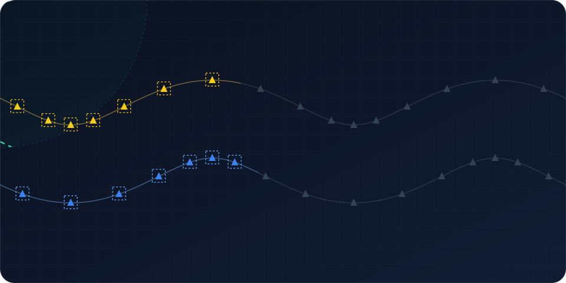
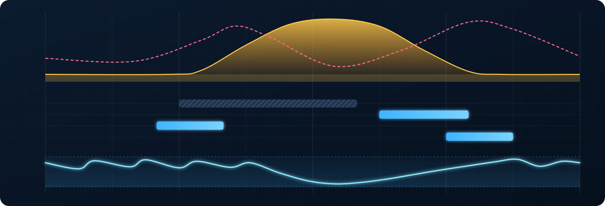
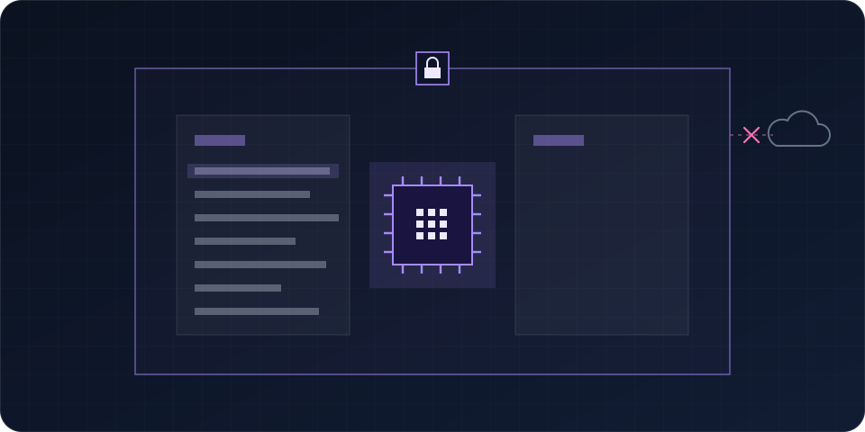

### [MCAV](https://github.com/ViDem02/MCAV) — Making autonomous flight more reliable.

Designed and tested control strategies for an autonomous quadrotor, exploring how a flying robot can remain stable and respect constraints when conditions change.

Autonomous systems · Control theory · Python · MuJoCo

### [Two-Tank LMI Control](https://github.com/ViDem02/LMI_PROJECT) — Speeding up a slow process without asking the impossible of its valves.

State-feedback and observer design for two water tanks in cascade, using Linear Matrix Inequalities. The chosen controller settles about **7× faster** than the open loop while every valve command stays between fully shut and fully open, and an observer rebuilds the level of tank 1 when its sensor fails.

Convex optimisation · State observers · MATLAB · YALMIP · MOSEK

### [PerceptionPipeline](https://github.com/ViDem02/PerceptionPipeline) — Helping a race car understand its surroundings.

A C++ perception system for driverless racing. It turns LiDAR data into an understanding of the track, estimates vehicle motion, and helps plan where the car should go next.

Robotics · Computer vision · C++ · LiDAR

### [CONCAST Optimisation](https://github.com/ViDem02/CONCAST-optimisation) — Smarter decisions for industrial energy use.

Explored how industrial processes and energy demand can be modelled and scheduled more efficiently, combining numerical optimisation with simulation and web-based tools.

**Repositories:** [CONCAST-optimisation](https://github.com/ViDem02/CONCAST-optimisation) (optimisation and simulation) · [concast-dashboard-main](https://github.com/ViDem02/concast-dashboard-main) (web dashboard)

Industrial optimisation · Python · Data analysis · Django / React

### [Secure Offline Translator](https://github.com/ViDem02/SecureOfflineTranslator) — Built to translate. Not to transmit.

A native macOS app for AI-powered technical translation, designed to keep sensitive text **on the user's computer** rather than sending it to a cloud service.

It runs its language model locally, checks model integrity, and uses a macOS App Sandbox configuration **without network entitlements**. The interface also shows whether the required sandbox is active. It's an exploration of a simple question: *Can modern AI be useful without giving it unrestricted access to your data?*

C++20 · Qt 6 · llama.cpp · Apple Metal · macOS App Sandbox

### [DataGatherer](https://github.com/ViDem02/DataGatherer) — Screenshots in. Structured data out.

A full-stack tool that turns collections of post screenshots into a user × hashtag dataset: crop once, let OCR read, confirm, export.

Django · React · Tesseract OCR · PostgreSQL · Docker

## What I work with

**Software:** Python, C++, MATLAB/Simulink, Qt, Django, React, Docker  
**Engineering:** Robotics, control, optimisation, simulation, computer vision  
**Applied AI:** On-device inference, machine learning, data processing

I care about the entire journey from **idea → implementation → validation** — not just whether something runs, but whether it works reliably and solves a meaningful problem.

---

[**LinkedIn**](https://www.linkedin.com/in/vidmtt02/) · [**Explore all repositories**](https://github.com/ViDem02?tab=repositories)
